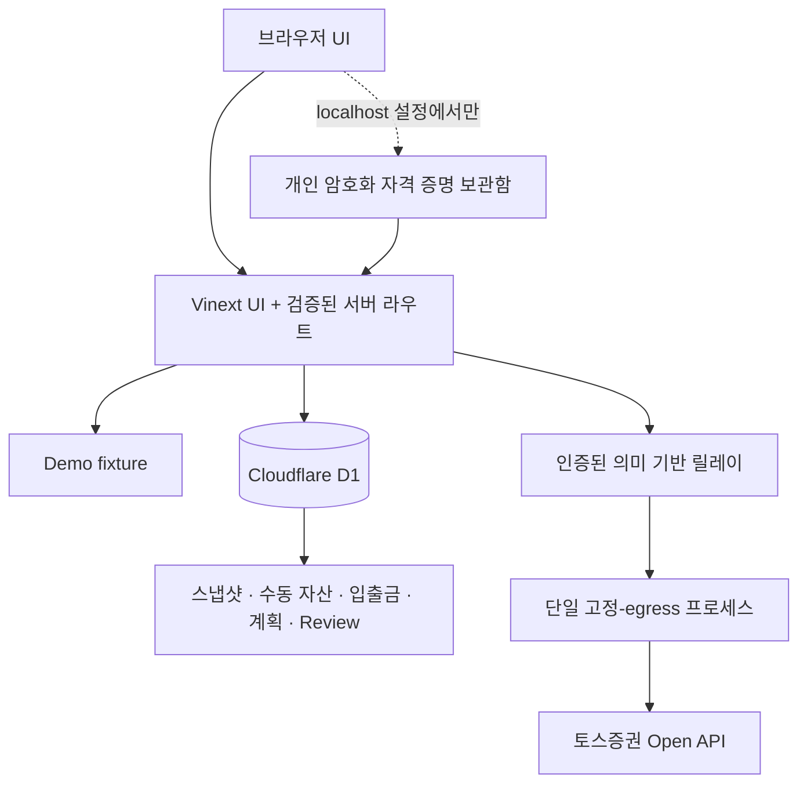

<div align="center">

# LedgerLens

**토스증권과 수동 등록 자산을 함께 보는 Demo-first 읽기 전용 개인 자산 콘솔**

[English](README.md) · 한국어

[](https://github.com/taehyeong51/LedgerLens/actions/workflows/ci.yml)
[](LICENSE)
[](package.json)
[](docs/SECURITY_ARCHITECTURE.md)

<picture>
  <source media="(prefers-color-scheme: dark)" srcset="docs/images/dashboard-dark.demo.jpg">
  
</picture>

</div>

> [!IMPORTANT]
> LedgerLens는 별도 설정이 필요 없는 **Demo 모드**가 기본입니다. 실계좌 연동 코드는 포함되어 있지만, 이 저장소가 고정-egress 릴레이, Toss WTS 허용 IP, 운영 비밀값 또는 실제 정기 캡처를 자동으로 프로비저닝하지는 않습니다. 인증 없는 공개 배포에서는 Demo 모드만 사용하세요.

## 왜 LedgerLens인가

스프레드시트는 개인 자산을 자유롭게 관리하기 좋지만 시세, 계좌 잔액, 이력과 검증을 반복해서 갱신해야 합니다. LedgerLens는 자산관리 시트처럼 빠르게 훑을 수 있는 화면에 서버측 읽기 전용 동기화, 정확한 십진 계산, 저장 이력과 명시적인 데이터 신뢰도 경계를 더합니다.

저장된 데이터보다 더 많이 아는 척하지 않으면서 다음 네 질문에 답하도록 설계했습니다.

1. 지금 등록된 자산은 얼마인가?
2. 자산군과 시장별 구성은 어떠한가?
3. 기록한 외부 입출금을 반영하면 저장 시점 사이에 무엇이 달라졌는가?
4. 다음에 확인할 데이터 공백이나 검토 행동은 무엇인가?

## 주요 기능

- 토스증권 OAuth, 계좌, 보유 종목, 현재가, 매수 가능 금액, USD/KRW 읽기 전용 조회
- 국내·미국 보유자산을 정확한 원화 포트폴리오 계약으로 정규화
- 현금, 예적금, 연금, 보험, 부동산, 가상자산, 기타 자산 수동 원장
- 전체 자산 요약, 자산 구성, 저장 이력, 기간 변화, 종목 스파크라인
- 불변 포트폴리오 스냅샷과 입금·출금 원장
- 증권 추적 자산의 현금흐름 조정 변화와 Modified Dietz 추정치
- 자본 계획, 목표 배분, 데이터 신뢰도 Review와 한 가지 후속 행동 기록
- CSV 미리보기 검증, 수식 실행 방지 내보내기, 제한된 가져오기와 멱등 재실행
- Demo, Direct, Relay로 분리된 fail-closed 서버 전용 자격 증명 구조
- 기본·다크 테마, 반응형 내비게이션, 키보드 조작과 차트 텍스트 대체 정보
- 주문 생성·정정·취소 및 범용 업스트림 프록시 없음

## 금융 데이터 해석 경계

LedgerLens는 **등록 자산 평가액**과 **투자 성과**를 의도적으로 분리합니다.

- 등록 자산 증가는 새 수동 자산 추가 때문일 수 있으며 자동으로 투자수익을 뜻하지 않습니다.
- 수동 자산은 현금흐름 관계가 확인되기 전까지 Modified Dietz에서 제외합니다.
- 계좌 바깥에서 들어온 입금과 계좌 밖으로 나간 출금만 외부 현금흐름으로 기록합니다. 종목 매매와 계좌 안의 환전은 외부 현금흐름이 아닙니다.
- 표시되는 Modified Dietz는 추적 자산 기준 기간 추정치이며 공식 TWR 또는 XIRR이 아닙니다.
- 매수 가능 금액은 결제 완료 현금과 다를 수 있습니다.
- 완전한 거래·배당·수수료·세금·실현손익 원장은 없습니다.
- 섹터 메타데이터가 없으면 시장별 구성을 섹터별 구성으로 부르지 않습니다.
- 투자·법률·회계·세무 자문 도구가 아닙니다.

## 빠른 시작 — Demo 모드

요구 사항: Node.js `>=22.13.0`, npm.

```bash
git clone https://github.com/taehyeong51/LedgerLens.git
cd LedgerLens
npm ci
npm run dev
```

[http://localhost:3000](http://localhost:3000)을 엽니다. Demo 모드는 `.env`, 토스 자격 증명 또는 DB 설정이 필요하지 않습니다.

Windows PowerShell에서 `npm.ps1` 실행 정책 문제가 있으면 다음 명령을 사용하세요.

```powershell
npm.cmd ci
npm.cmd run dev
```

## 실행 모드

| 모드 | 사용 목적 | 비밀값 저장 위치 | 공개 호스팅 |
| --- | --- | --- | --- |
| Demo | 로컬 미리보기, CI, 공개 쇼케이스 | 없음 | 허용 |
| Direct | WTS 허용 IP가 등록된 개인 서버 한 대 | 서버 환경변수 또는 해당 서버의 암호화 보관함 | 별도 인증 경계 없이는 금지 |
| Relay | owner-only 웹앱과 고정-egress 프로세스 | 릴레이 프로세스, 웹앱에는 전용 공유 토큰만 저장 | 신뢰된 서버측 사용자 식별 필수 |

Relay 설정이 Direct보다 우선합니다. Toss는 Client 하나당 유효한 OAuth 토큰 하나만 허용하므로, 토큰을 소유하는 Direct/Relay 프로세스는 분산 토큰 조정 기능을 추가하기 전까지 단일 인스턴스로 운영해야 합니다.

## 아키텍처



릴레이는 제한된 `GET /api/relay/portfolio` 계약만 제공합니다. 호출자가 업스트림 URL, 메서드, 계좌 헤더, 쿼리 또는 본문을 선택할 수 없으며 토스 주문 엔드포인트도 포함하지 않습니다.

## 실계좌 연결

각 사용자는 자신의 Toss Open API Client를 두 가지 개인용·서버 전용 방식 중 하나로 연결할 수 있습니다. 어느 방식도 Client Secret을 브라우저 저장소에 보관하지 않습니다.

### 방법 A — 로컬 암호화 보관함

1. 이 PC/서버의 공인 egress IP를 Toss WTS의 Open API 허용 IP에 등록합니다.
2. LedgerLens를 실행한 같은 PC에서 `http://localhost:3000/#data`를 엽니다.
3. **내 Toss Open API 연결**에 Client ID와 Client Secret을 입력하고, 마스킹된 계좌 목록을 검증합니다.
4. 사용할 계좌를 선택한 뒤 12자 이상의 보관함 암호를 정합니다.

자격 증명은 PBKDF2-SHA-256과 AES-256-GCM으로 암호화되어 Git에서 제외된 `private-data/toss-credentials.v1.json`에 저장됩니다. 보관함 암호는 저장되지 않으며 분실 시 복구할 수 없습니다. 복호화된 값은 최대 8시간 동안 서버 메모리에만 있고, 서버 재시작 또는 시간 만료 후에는 다시 잠금을 풀어야 합니다. 공개·원격 URL에서는 보관함 관리 기능이 차단되며 전체 계좌번호와 Toss `accountSeq`는 브라우저 응답에 포함되지 않습니다.

이 기능은 **개인 로컬/셀프호스트 인스턴스용 단일 사용자 보관함**입니다. 여러 사용자의 키를 받는 공용 SaaS 비밀 저장소가 아니며, 공개 Demo 배포에서는 개인 키를 입력받으면 안 됩니다.

### 방법 B — 서버 환경변수

```powershell
Copy-Item .env.example .env.local
```

공인 egress IP가 Toss WTS에 등록된 단일 서버에서만 다음 값을 설정합니다.

```dotenv
TOSS_DIRECT_API_ENABLED=true
TOSS_CLIENT_ID=your_client_id
TOSS_CLIENT_SECRET=your_client_secret
TOSS_ACCOUNT_SEQ=
LEDGERLENS_ALLOW_LOCAL_HISTORY=true
```

`NEXT_PUBLIC_*`를 사용하거나 `.env.local`을 커밋하지 마세요. Toss 액세스 토큰을 릴레이 토큰으로 재사용하거나 인증 없는 공개 서버에서 Direct 모드를 켜면 안 됩니다. owner-only 배포는 [보안 아키텍처](docs/SECURITY_ARCHITECTURE.md)와 [릴레이 배포 가이드](docs/RELAY_DEPLOYMENT.md)를 먼저 확인하세요.

읽기 전용 어댑터는 Toss의 공식 [Open API 가이드](https://developers.tossinvest.com/docs)와 OpenAPI `1.2.14`를 기준으로 관리합니다. Toss는 Client 하나당 유효 토큰 하나만 발급하고 등록된 egress IP를 확인하므로 같은 Client로 토큰 소유 인스턴스를 여러 개 실행하지 마세요.

## 저장소 구조

```text
LedgerLens/
├─ app/
│  ├─ api/                 # 입력 검증과 권한 경계가 있는 서버 라우트
│  ├─ components/          # 대시보드, 원장, 차트, Review UI
│  └─ lib/                 # UI 계약과 표시 포맷터
├─ lib/
│  ├─ toss/                # 서버 전용 OpenAPI 클라이언트
│  ├─ portfolio/           # 포트폴리오 정규화와 정확한 십진 계산
│  ├─ dashboard/           # 전체 자산 대시보드 집계
│  ├─ history/             # 불변 증권 스냅샷
│  ├─ assets/              # 수동 자산, 진단, CSV
│  ├─ cashflow/            # 불변 외부 입출금
│  ├─ analytics/           # 조정 변화와 Modified Dietz
│  ├─ planning/            # 자본 계획 검증·저장
│  ├─ review/              # Review 사실과 저널
│  ├─ credentials/         # localhost 전용 개인 암호화 보관함
│  └─ automation/          # 일정과 캡처 실행 상태
├─ db/                     # D1/Drizzle 스키마 바인딩
├─ drizzle/                # 버전 관리 마이그레이션
├─ worker/                 # Cloudflare fetch/scheduled 진입점
├─ infra/relay/            # 제한된 릴레이 게이트웨이·감시 프로세스
├─ docs/                   # 보안, 배포, 디자인, 공개 이미지
├─ examples/               # 명백한 가상 Demo fixture만 포함
├─ tests/                  # 결정론적 보안·도메인 회귀 테스트
└─ public/                 # 정적·소셜 미리보기 자산
```

## 개발 명령

| 명령 | 목적 |
| --- | --- |
| `npm run dev` | Vinext 개발 서버 시작 |
| `npm run lint` | TypeScript, React, Hooks, 접근성 린트 |
| `npm run build` | 프로덕션 Worker와 standalone 출력 빌드 |
| `npm test` | 빌드 후 전체 Node 회귀 테스트 실행 |
| `npm run audit:security` | 의존성 보안 게이트 검사 |
| `npm run db:generate` | 스키마 변경 후 Drizzle migration 생성 |

테스트에는 실제 토스 자격 증명, 배포된 릴레이, 운영 D1 데이터 또는 Cron 트리거가 필요하지 않습니다.

## 배포 범위

- **공개 쇼케이스:** Demo 모드만 허용
- **개인 로컬 사용:** WTS 고정 IP 등록 후 Direct 모드 사용 가능
- **owner-only 웹 사용:** 신뢰된 로그인 경계와 단일 고정-egress 릴레이 필수
- **정기 스냅샷:** Worker에 목표 일정은 있지만 외부 Cron을 별도로 만들고 실제 실행을 관측해야 함
- `Dockerfile.relay`는 제한된 릴레이 런타임이며 범용 공개 올인원 이미지가 아님

사용자 전용 `.openai/hosting.json`은 Git에서 제외합니다. 저장소는 해당 파일 없이 로컬 `DB` 바인딩 fallback으로 빌드되며, 자신의 Sites 프로젝트를 구성할 때만 `.openai/hosting.example.json`을 참고하세요.

## 문서

- [보안 정책](SECURITY.md)
- [보안 아키텍처](docs/SECURITY_ARCHITECTURE.md)
- [고정-egress 릴레이 배포](docs/RELAY_DEPLOYMENT.md)
- [의존성 보안 정책](docs/DEPENDENCY_SECURITY.md)
- [제품 원칙](PRODUCT.md)
- [디자인 시스템](DESIGN.md)
- [기여 가이드](CONTRIBUTING.md)

## 알려진 한계와 로드맵

- 섹터 메타데이터와 검증된 섹터별 자산 구성은 아직 없습니다.
- 완전한 거래·배당·수수료·세금 원장과 실현손익은 없습니다.
- 종목 이력의 로딩·조회 실패·기록 부족 상태를 더 세분화해야 합니다.
- 현재 24개월 성장 기간은 `2Y`로 표시하거나 실제 전체 이력을 조회하도록 개선해야 합니다.
- 고정-egress 호스팅, WTS 허용 IP, 운영 비밀값과 첫 실제 정기 캡처는 운영자가 별도로 수행합니다.

## 보안

실제 `.env`, 액세스 토큰, 계좌번호, 포트폴리오 CSV 또는 실계좌 화면을 Issue에 첨부하지 마세요. 취약점은 [SECURITY.md](SECURITY.md)의 비공개 절차로 제보해야 하며 공개 화면과 fixture는 항상 Demo 데이터만 사용합니다.

## 기여

[CONTRIBUTING.md](CONTRIBUTING.md)를 확인하고 읽기 전용·결정론적 경계를 유지한 뒤 다음 명령을 실행하세요.

```bash
npm run lint
npm test
```

## 라이선스

[MIT](LICENSE) © 2026 taehyeong51.

## 면책

LedgerLens는 토스증권과 독립된 오픈소스 프로젝트이며 토스증권의 공식 제품, 보증 또는 제휴 서비스가 아닙니다. 사용에 따른 책임은 사용자에게 있으며 금융 정보는 반드시 원 기관 자료와 대조하세요.
