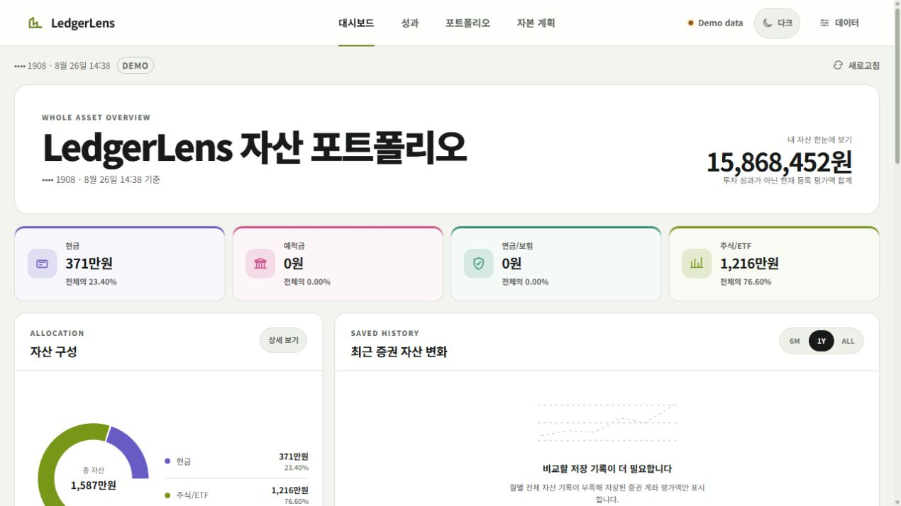
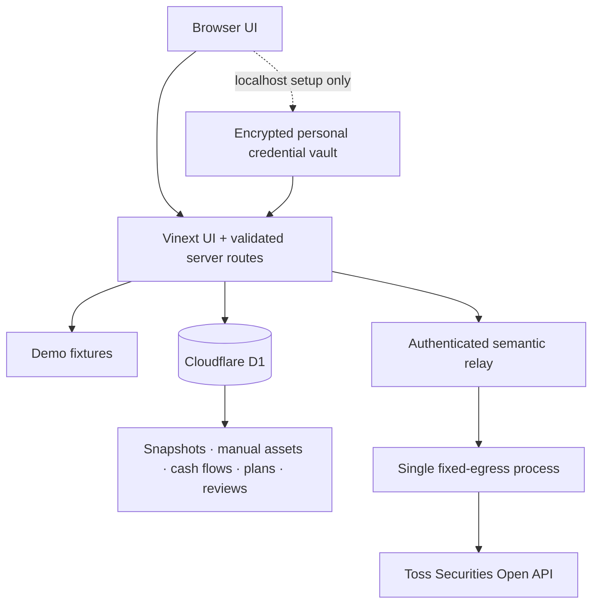

<div align="center">

# LedgerLens

**A demo-first, read-only personal asset console for Toss Securities and manually tracked assets.**

English · [한국어](README.ko.md)

[](https://github.com/taehyeong51/LedgerLens/actions/workflows/ci.yml)
[](LICENSE)
[](package.json)
[](docs/SECURITY_ARCHITECTURE.md)

<picture>
  <source media="(prefers-color-scheme: dark)" srcset="docs/images/dashboard-dark.demo.jpg">
  
</picture>

</div>

> [!IMPORTANT]
> LedgerLens is safe-by-default in **Demo mode** and needs no credentials to run. Live integration code is included, but this repository does not provision a fixed-egress relay, Toss WTS IP allowlisting, production secrets, or a verified scheduled capture. Public unauthenticated deployments must remain in Demo mode.

## Why LedgerLens

Spreadsheets make personal asset management flexible, but market prices, account balances, history, and validation quickly become repetitive. LedgerLens keeps the spreadsheet-like scanability while adding server-side read-only synchronization, exact-decimal calculations, durable records, and explicit data-quality boundaries.

The app is designed to answer four questions without pretending to know more than the stored data supports:

1. What assets are currently registered?
2. How are they allocated across broad asset groups and markets?
3. What changed across saved observations after recorded external cash flows?
4. Which data gap or review action needs attention next?

## Features

- Read-only Toss Securities OAuth, account, holdings, prices, buying power, and USD/KRW ingestion.
- Domestic and US holdings normalized to an exact KRW portfolio contract.
- Manual ledgers for cash, deposits, savings, pensions, insurance, property, crypto, and other assets.
- Whole-asset overview, allocation donuts, saved history, period-change charts, and holding sparklines.
- Immutable portfolio snapshots and contribution/withdrawal records.
- Cash-flow-adjusted change and Modified Dietz estimate over tracked brokerage assets.
- Capital plan, target-allocation, reliability review, and one-action review journal.
- CSV dry-run validation, formula-safe export, bounded import, and idempotent replay.
- Demo, Direct, and Relay modes with fail-closed server-only credential handling.
- Default light and persistent dark themes, responsive navigation, keyboard support, and textual chart equivalents.
- No order creation, modification, cancellation, or arbitrary upstream proxy.

## Financial data boundaries

LedgerLens deliberately separates **registered valuation** from **investment performance**.

- A rise in registered assets may come from a newly added manual asset; it is not automatically investment return.
- Manual assets are excluded from Modified Dietz until their cash-flow relationship is known.
- Only contributions entering from outside the tracked account and withdrawals leaving it are external cash flows; security trades and FX inside the account are not.
- The displayed Modified Dietz value is a period estimate over tracked assets, not official TWR or XIRR.
- Buying power may differ from settled cash.
- There is no complete trade, dividend, fee, tax, or realized-profit ledger.
- Market allocation is not labeled as sector allocation without sector metadata.
- The app does not provide investment, legal, accounting, or tax advice.

## Quick start — Demo mode

Requirements: Node.js `>=22.13.0` and npm.

```bash
git clone https://github.com/taehyeong51/LedgerLens.git
cd LedgerLens
npm ci
npm run dev
```

Open [http://localhost:3000](http://localhost:3000). No `.env` file, Toss credential, or database setup is required for Demo mode.

Windows PowerShell users can avoid the `npm.ps1` execution-policy shim:

```powershell
npm.cmd ci
npm.cmd run dev
```

## Runtime modes

| Mode | Intended use | Where secrets live | Public hosting |
| --- | --- | --- | --- |
| Demo | Local preview, CI, public showcase | No secrets | Allowed |
| Direct | One personal server with a WTS-allowlisted fixed egress IP | Server environment or its encrypted local vault | Never without a separate authentication boundary |
| Relay | Owner-only web app connected to a fixed-egress process | Relay process; web app receives only a dedicated shared relay token | Requires trusted server-side identity |

Relay configuration takes precedence over Direct configuration. Toss allows only one active OAuth token per client, so a token-owning Direct/Relay process must remain single-instance unless distributed token coordination is added.

## Architecture



The relay exposes only a bounded `GET /api/relay/portfolio` contract. Callers cannot choose an upstream URL, method, account header, query, or request body. The application contains no Toss order endpoint.

## Connecting live data

Each user can connect their own Toss Open API client in one of two personal, server-only ways. Neither option puts a Client Secret in browser storage.

### Option A — encrypted local vault

1. Register the PC/server's public egress IP in Toss WTS Open API settings.
2. Run LedgerLens and open `http://localhost:3000/#data` on that same machine.
3. In **My Toss Open API connection**, enter the Client ID and Client Secret, then validate the returned masked account list.
4. Select an account and choose a vault passphrase of at least 12 characters.

LedgerLens encrypts the credentials with PBKDF2-SHA-256 and AES-256-GCM into the Git-ignored `private-data/toss-credentials.v1.json` file. The passphrase is not stored or recoverable. Decrypted credentials remain only in server memory for up to eight hours and must be unlocked again after a restart or timeout. Vault management is blocked on non-loopback/public URLs, and full account numbers plus Toss `accountSeq` values never enter the browser response.

This is a **single-user local/self-hosted vault**, not a shared multi-user secret service. A public Demo deployment must not accept personal keys.

### Option B — server environment

```powershell
Copy-Item .env.example .env.local
```

Set these values only on a single server whose public egress IP is registered in Toss WTS:

```dotenv
TOSS_DIRECT_API_ENABLED=true
TOSS_CLIENT_ID=your_client_id
TOSS_CLIENT_SECRET=your_client_secret
TOSS_ACCOUNT_SEQ=
LEDGERLENS_ALLOW_LOCAL_HISTORY=true
```

Do not use `NEXT_PUBLIC_*`, commit `.env.local`, reuse a Toss access token as a relay token, or expose Direct mode on an unauthenticated public host. For owner-only hosted setups, follow [Security Architecture](docs/SECURITY_ARCHITECTURE.md) and [Relay Deployment](docs/RELAY_DEPLOYMENT.md).

The read-only adapter is maintained against the official [Toss Invest Open API guide](https://developers.tossinvest.com/docs) and OpenAPI `1.2.14`. Toss issues one valid access token per client and checks the registered egress IP, so do not run multiple token-owning instances with the same client.

## Repository structure

```text
LedgerLens/
├─ app/
│  ├─ api/                 # validated read/write server routes
│  ├─ components/          # dashboard, ledgers, charts, review UI
│  └─ lib/                 # UI contracts and formatters
├─ lib/
│  ├─ toss/                # server-only OpenAPI client
│  ├─ portfolio/           # normalized portfolio + exact decimals
│  ├─ dashboard/           # whole-asset dashboard aggregation
│  ├─ history/             # immutable brokerage snapshots
│  ├─ assets/              # manual assets, diagnostics, CSV
│  ├─ cashflow/            # immutable external cash flows
│  ├─ analytics/           # adjusted change and Modified Dietz
│  ├─ planning/            # capital plan validation/storage
│  ├─ review/              # review facts and journal
│  ├─ credentials/         # encrypted loopback-only personal vault
│  └─ automation/          # schedule and capture-run state
├─ db/                     # D1/Drizzle schema bindings
├─ drizzle/                # versioned migrations
├─ worker/                 # Cloudflare fetch/scheduled entry point
├─ infra/relay/            # constrained relay gateway/supervisor
├─ docs/                   # security, deployment, design, images
├─ examples/               # unmistakably fictional Demo fixtures
├─ tests/                  # deterministic security/domain regressions
└─ public/                 # static and social-preview assets
```

## Development commands

| Command | Purpose |
| --- | --- |
| `npm run dev` | Start the Vinext development server |
| `npm run lint` | Run TypeScript, React, Hooks, and accessibility lint rules |
| `npm run build` | Build production Worker and standalone output |
| `npm test` | Build, then run the deterministic Node test suite |
| `npm run audit:security` | Enforce dependency security gates |
| `npm run db:generate` | Generate Drizzle migrations after schema changes |

Tests do not require real Toss credentials, deployed relays, production D1 data, or Cron triggers.

## Deployment scope

- **Public showcase:** Demo mode only.
- **Personal local use:** Direct mode may be used after WTS fixed-IP allowlisting.
- **Owner-only web use:** a trusted login boundary plus a single fixed-egress relay is required.
- **Scheduled snapshots:** the Worker contains the target schedule, but the external Cron control-plane must still be provisioned and observed.
- `Dockerfile.relay` is a constrained relay runtime, not a generic public all-in-one deployment image.

An owner-specific `.openai/hosting.json` is intentionally ignored. The repository builds with a local `DB` binding fallback; copy `.openai/hosting.example.json` only when configuring your own Sites project.

## Documentation

- [Security policy](SECURITY.md)
- [Security architecture](docs/SECURITY_ARCHITECTURE.md)
- [Fixed-egress relay deployment](docs/RELAY_DEPLOYMENT.md)
- [Dependency security policy](docs/DEPENDENCY_SECURITY.md)
- [Product principles](PRODUCT.md)
- [Design system](DESIGN.md)
- [Contributing](CONTRIBUTING.md)

## Known limitations and roadmap

- Sector metadata and a verified sector-allocation view are not implemented.
- A complete trade/dividend/fee/tax ledger and realized P/L are not implemented.
- Holding-history loading, failure, and insufficient-history states need finer separation.
- The current 24-month growth control should be labeled `2Y` or backed by truly unbounded history.
- Fixed-egress hosting, WTS allowlisting, hosted secrets, and the first real scheduled capture are operator tasks, not repository defaults.

## Security

Never attach a real `.env`, access token, account number, portfolio export, or live screenshot to an issue. Report vulnerabilities privately as described in [SECURITY.md](SECURITY.md). Public screenshots and fixtures must remain Demo-only.

## Contributing

Read [CONTRIBUTING.md](CONTRIBUTING.md), keep changes read-only and deterministic, and run:

```bash
npm run lint
npm test
```

## License

[MIT](LICENSE) © 2026 taehyeong51.

## Disclaimer

LedgerLens is an independent open-source project and is not affiliated with, endorsed by, or an official product of Toss Securities. Use it at your own risk and verify financial information against the original institution.
