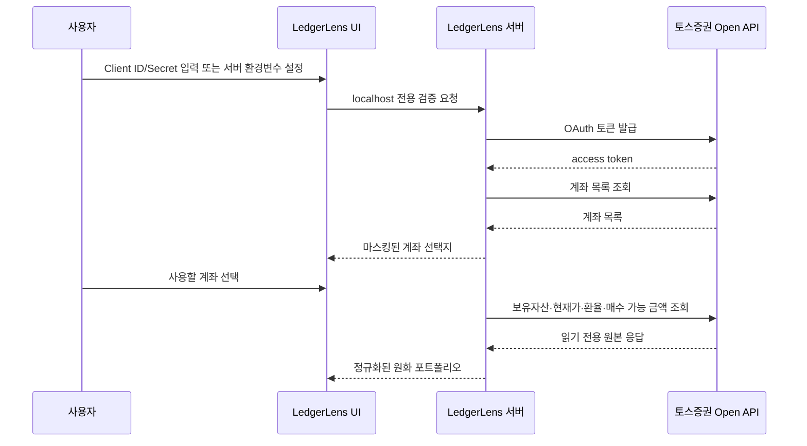

# 토스증권 Open API 연동

LedgerLens는 토스증권 Open API로 증권 계좌의 현재 상태를 읽고, 수동 등록 자산과 함께 검토할 수 있도록 정규화하는 **비공식 읽기 전용 오픈소스 프로젝트**입니다. 토스증권의 공식 제품이나 제휴 서비스가 아니며 주문·자동매매 기능을 제공하지 않습니다.

이 문서는 LedgerLens가 실제로 사용하는 API, 사용자 화면에 반영되는 방식과 보안 경계를 설명합니다. 구현은 토스증권 공식 OpenAPI `1.2.14`를 기준으로 관리합니다.

## 사용자가 얻는 자동화

토스증권 계좌를 연결하면 다음 작업을 반복 입력하지 않아도 됩니다.

- 계좌 목록과 사용할 증권 계좌 확인
- 국내·미국 보유 주식 및 ETF 수량 조회
- 보유 종목 현재가 갱신
- 평균단가, 평가금액과 평가손익 수집
- 원화·달러 매수 가능 금액 조회
- USD/KRW 환율을 이용한 원화 기준 합산
- 현재 포트폴리오의 국내·미국 시장 비중 계산
- 저장 스냅샷을 이용한 기간별 변화와 종목 가격 흐름 표시

토스증권이 제공하지 않거나 LedgerLens가 아직 수집하지 않는 현금·예적금·연금·보험·부동산·가상자산 등은 사용자가 화면 또는 CSV로 등록합니다.

## 실제 호출 엔드포인트

| 순서 | 엔드포인트 | 인증 | 사용 목적 |
| --- | --- | --- | --- |
| 1 | `POST /oauth2/token` | Client ID + Client Secret | Client Credentials 방식 액세스 토큰 발급 |
| 2 | `GET /api/v1/accounts` | Bearer token | 사용 가능한 계좌 목록 조회 |
| 3 | `GET /api/v1/holdings` | Bearer token + 계좌 헤더 | 보유 종목과 합산 평가 정보 조회 |
| 4 | `GET /api/v1/prices` | Bearer token | 보유 종목 현재가 다건 조회 |
| 5 | `GET /api/v1/exchange-rate` | Bearer token | USD/KRW 환율 조회 |
| 6 | `GET /api/v1/buying-power` | Bearer token + 계좌 헤더 | KRW·USD 매수 가능 금액 조회 |

계좌가 필요한 요청은 `X-Tossinvest-Account` 헤더를 서버에서 추가합니다. 브라우저 사용자가 임의의 계좌 헤더, 업스트림 URL, HTTP 메서드 또는 요청 본문을 지정할 수 없습니다.

## 동기화 흐름



## 현재가와 환율 처리

- 현재가 API 한 번에 최대 200개 심볼을 전달합니다.
- 중복 심볼을 제거하고, 200개를 넘으면 순차 요청으로 나눠 불필요한 순간 요청 폭증을 피합니다.
- LedgerLens 내부 총 허용량은 2,000개 심볼로 제한합니다.
- 미국 자산은 원본 USD 값을 유지하면서 현재 USD/KRW 환율로 원화 평가액을 계산합니다.
- 금액, 수량, 가격과 환율은 부동소수점으로 합산하지 않고 십진 문자열 기반 계산을 사용합니다.

## OAuth 토큰 처리

- 액세스 토큰은 브라우저로 전달하지 않고 서버 메모리에만 캐시합니다.
- 만료 시점보다 조금 일찍 새 토큰을 요청합니다.
- 같은 자격 증명의 동시 토큰 요청은 하나의 발급 작업으로 합칩니다.
- API가 `401`을 반환하면 기존 토큰을 폐기하고 한 번만 재발급한 뒤 요청을 다시 시도합니다.
- 토스증권 Client 하나를 여러 서버 인스턴스가 동시에 사용하지 않는 구성이 기본입니다.

## 자격 증명 저장 방식

### localhost 암호화 보관함

Data 화면에서 Client ID와 Client Secret을 검증하고 계좌를 선택합니다. 자격 증명은 PBKDF2-SHA-256과 AES-256-GCM으로 암호화되어 `private-data/toss-credentials.v1.json`에 저장되며 이 디렉터리는 Git에서 제외됩니다. 보관함 암호는 저장하지 않고, 복호화된 값은 최대 8시간 동안 서버 메모리에만 유지합니다.

이 보관함은 개인 localhost·셀프호스트 인스턴스용입니다. 공개 URL에서는 보관함 API와 UI를 차단하며 여러 사용자의 비밀값을 보관하는 SaaS 기능이 아닙니다.

### 서버 환경변수

고정된 공인 송신 IP를 가진 개인 서버에서는 다음 값을 서버 환경변수로 전달할 수 있습니다.

```dotenv
TOSS_DIRECT_API_ENABLED=true
TOSS_CLIENT_ID=
TOSS_CLIENT_SECRET=
TOSS_ACCOUNT_SEQ=
```

브라우저에 노출되는 `NEXT_PUBLIC_*` 변수에는 토스증권 자격 증명을 넣으면 안 됩니다.

### 고정-egress 릴레이

외부 또는 모바일에서 owner-only 웹앱으로 접근하려면 토스 WTS에 등록할 수 있는 고정 송신 IP가 필요합니다. LedgerLens 릴레이는 제한된 `GET /api/relay/portfolio` 결과만 반환하며 토스증권 액세스 토큰, Client Secret 또는 범용 프록시 기능을 공개하지 않습니다.

## WTS 허용 IP

토스증권 WTS의 Open API 설정에서 API를 호출할 서버의 공인 IP를 등록해야 합니다. 등록되지 않은 IP에서는 요청이 거절될 수 있습니다. 가정용 회선처럼 공인 IP가 변경되거나 여러 송신 IP를 사용하는 서버리스 환경에서는 Direct 연결이 불안정할 수 있으므로 고정-egress 서버 또는 제한된 릴레이가 필요합니다.

## 의도적으로 지원하지 않는 기능

LedgerLens는 다음 엔드포인트를 호출하지 않습니다.

- 주식 주문 생성
- 주문 정정·취소
- 조건주문 등록·수정·취소
- 사용자가 업스트림 URL을 지정하는 범용 프록시
- 자동매매 또는 매수·매도 추천

공개 기여에서도 읽기 전용 경계를 유지해야 합니다. 주문 기능이 필요한 프로젝트라면 LedgerLens와 분리된 별도 보안·승인·감사 체계로 설계해야 합니다.

## 관련 문서

- [토스증권 Open API 공식 가이드](https://developers.tossinvest.com/docs)
- [보안 아키텍처](SECURITY_ARCHITECTURE.md)
- [고정-egress 릴레이 배포](RELAY_DEPLOYMENT.md)
- [프로젝트 보안 정책](../SECURITY.md)
